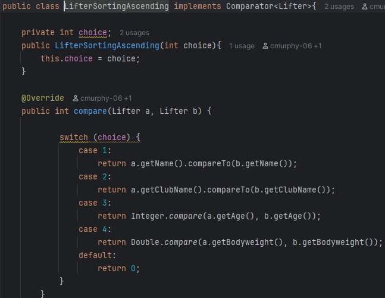
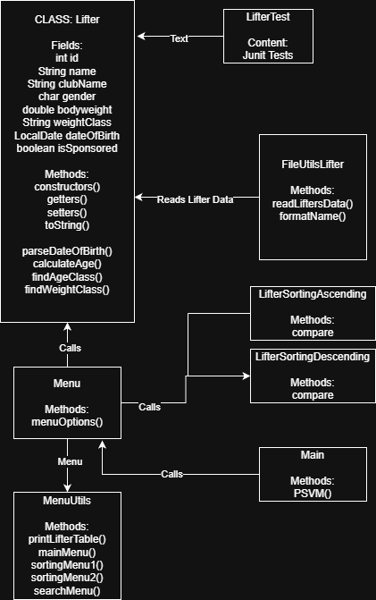

# :muscle: G-CA1 OOP: Conor Murphy & Conor McCracken
## Entities :
### :one: 🏋️‍♂️ Entity: Lifter
The "Lifter" entity represents each lifter in a powerlifting competition. This class diagram describes the lifters personal details, physical details and compeition category.

| Field              | Type      |Decription                       | Example                                       |
|:--                 |:--        |:--                              |:--                                            |
| id                 | int       | Unique ID for each lifter       | 12                                            |
| name               | String    | Lifter's full Name              | "John Smith"                                  |
| clubName           | String    | Club lifter represents          | "Odyssey Strength"                            |
| gender             | char      | Clarify the lifters gender      | 'M'                                           |
| bodyweight         | double    | Lifter's Bodyweight             | 73.9                                          |
| dateOfBirth        | LocalDate | Lifter's DOB                    | 01-02-2000                                    |
| isSponsored        | boolean   | If the lifter is sponsored      | false                                         |
| age                | int       | Lifter's age                    | 25                                            |
| ageClass           | String    | Lifter's age category           | "Junior"                                      |
| equiptmentUsedType | String [] | What equiptment type/brand used | "SBD Knee Sleeves","SBD Belt","A7 Wrist Wraps |
| weightClass        | String    | Based of gender and weight      | "U-74KG Men"                                  |
---
### :two: :gear: Entity: Equiptment
| Field              | Type      |Decription                                           | Example                                       |
|:--                 |:--        |:--                                                  |:--                                            |
| id                 | int       | Unique ID for each lifters list of equiptmnet       | 12                                            |
| belt               | String    | Lifter's belt                                       | "A7 Belt"                                     |
| singlet            | String    | Lifter's singlet                                    | "SBD Singlet"                                 |
| compTee            | String    | Lifter's comp t-shirt                               | "Strength Shop T-Shirt"                       |
| wristWraps         | String    | Lifter's wrist wraps                                | "SBD Wrist Wraps                              |
| kneeSleeves        | String    | Lifter's knee sleeves                               | "A7 Knee Sleeves"                             |
| socks              | String    | Lifter's socks                                      | "SBD Socks"                                   |
| deadliftSocks      | String    | Lifter's deadlift socks                             | "SBD Deadlift Socks"                          |
| shoes              | String    | Lifter's shoes                                      | "Notorious Lift"                              |

## :three: 🥇 Entity: Competition
| Field              | Type                  |Decription                                           | Example                          |
|:--                 |:--                    |:--                                                  |:--                               |
| id                 | int                   | Unique ID for each lifters list of equiptmnet       | 1                                |
| name               | String                | Name of competition                                 | "Open Nationals"                 |
| location           | String                | Name of competition's location                      | "Cork"                           |
| date               | String                | Date of competition                                 | "12-12-25"                       |
| lifters            | ArrayList<Lifter      | All lifters in the compeition                       | [{"John Murphy}{"Conor Adams"}   |

## :four: 🏋️ Entity: Lifter Result
| Field              | Type                  |Decription                                                 | Example                          |
|:--                 |:--                    |:--                                                        |:--                               |
| lifter             | Lifter                | Each Lifter                                               | Lifter lifter1                   |
| id                 | int                   | Unique ID for each lifters list of equiptmnet             | 1                                |
| squat              | double                | Lifter's squat result                                     | 212.5                            |
| bench              | double                | Lifter's bench result                                     | 110.0                            |
| deadlift           | double                | Lifter's deadlift result                                  | 245.0                            |
| total              | double                | Lifter's total result: squat + bench + deadlift           | 577.5                            |
| dots               | double                | Lifter's dots result: Calulated with bodyweight and total | 452.00                           |

### :two: 🔍 Lifter Overview
#### :two:.:one:  :deciduous_tree: Strucutre Tree of Lifter Folder
```
│
└───src
    │   Competition.java
    │   CompetitionResult.java
    │   Equipment.java
    │   Main.java
    │   Menu.java
    │
    └───Lifter
            FileUtilsLifter.java
            Lifter.java
            LifterSortingFiltering.java
            LifterTest.java
```
#### :two:.:two:: 📌 Purpose of this Class
---

The purpose of this class is to keep the lifters data read from an AI generated csv file from ChatGPT. We initially read all the data from our FileUtils Class and this data is passed into the lifters class via and ArrayList<Lifter>. We used an arraylist because we needed to take in various type of fields such as an int, String, boolean etc, and this cannot be done using a standard array. We then can use this information to sort lifters that match certain categories, ie. Filtering by name ascending. In the FileUtils Class we also read data from another csv file that reads a string array (String []) and then this information is inputed into the lifter.equipmentUsed as the original lifter information is being passed.
As we develop our project further this will eventually become a child class to Competition Results which will be a child class of Competitions.

---
#### :two:.:three: 📃 CSV Files
As stated above both our liftersData.csv and lifterEquipment.csv were generated using chatGPT. This sped up the process as it would take a numerous amount of time to create these files with such a large dataset. This allows for a more "real world" scenerio and gives our methods more data to work off, showing there true functionality. We prompted chatGPT to create inconsistencies within the capitalisation and spacing between the strings name and clubName. This allowed us to create error handling, to make these more readable, again preparing for human error in a "real world" scenario.

---
### :three: 📚 Design Choices and Explanation

#### :three:.:one:: :Methods
---


This method assigns a weight class to a lifter based off their weight and gender, this makes the information also more readable at a glance while also retaining crucuial function for the usecase.<br/><br/>

This method takes in what the user wants to sort and the direction they want to sort it in , from the menu and uses it to display the sorted table. The options include : Name, Age, Club and Weight. This is as much as the user would likely need as you can discern the weight and age classes from the respective weight and ages of the lifters in the table. 


#### :three:.:two:: 🤝 Classes and Relationships
---

This is a class and relationships diagram, to show how the classes relate to one and another and to show how parent classes relate to child classes. This made our development process easier to understand and carry out, it also created visualisation and gave us more insight into how the final result would look. Additionally it enhanced our ability to integrate defensive coding as we were able to go back and re-evaluate where our system could potentially fail. In summary, it created a broader outlook of the system and its output. 
<br/>
<br/>


#### :three:.:three:: Lifter J-Unit Tests
---

Includes testing for the application of the weight and age classes, all of the tests passed under varying realistic and unrealistic parameters<br/></br>

#### :three:.:four: Sample Outputs
---
1st Menu <br/><br/>

<br/><br/>
2nd Menu <br/><br/>

<br/><br/>
3rd Menu <br/><br/>

<br/><br/>
4th Menu <br/><br/>

<br/><br/>

---
#### References 📘 <br/>
##### Code 💻 <br/>
CSV File Generation: www.chatgpt.com <br/>
LocalDate formatting (turning string into LocalDate)://https://www.digitalocean.com/community/tutorials/java-simpledateformat-java-date-format <br/>
LocalDate docs: //https://docs.oracle.com/javase/8/docs/api/java/time/LocalDate.html <br/>
##### General Research 🗺️ <br/>
Maximum Age Recorded: //https://www.washington.edu/news/2021/07/01/how-long-can-a-person-live-the-21st-century-may-see-a-record-breaker/ <br/>
Maximum Weight Recorded (Man) : //https://en.wikipedia.org/wiki/Jon_Brower_Minnoch <br/>
Maximum Weight Recorded (Woman) : //https://en.wikipedia.org/wiki/Carol_Yager <br/>


