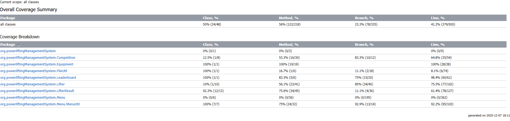

# :muscle: G-CA1 OOP: Conor Murphy & Conor McCracken
## Entities :
### :one: 🏋️‍♂️ Entity: Lifter
The "Lifter" entity represents each lifter in a powerlifting competition. This class diagram describes the lifters personal details, physical details and compeition category.

| Field              | Type      |Decription                       | Example                                       |
|:--                 |:--        |:--                              |:--                                            |
| id                 | int       | Unique ID for each lifter       | 12                                            |
| name               | String    | Lifter's full Name              | "John Smith"                                  |
| clubName           | String    | Club lifter represents          | "Odyssey Strength"                            |
| gender             | char      | Clarify the lifters gender      | 'M'                                           |
| bodyweight         | double    | Lifter's Bodyweight             | 73.9                                          |
| dateOfBirth        | LocalDate | Lifter's DOB                    | 01-02-2000                                    |
| isSponsored        | boolean   | If the lifter is sponsored      | false                                         |
| age                | int       | Lifter's age                    | 25                                            |
| ageClass           | String    | Lifter's age category           | "Junior"                                      |
| equiptmentUsedType | String [] | What equiptment type/brand used | "SBD Knee Sleeves","SBD Belt","A7 Wrist Wraps |
| weightClass        | String    | Based of gender and weight      | "U-74KG Men"                                  |
---
### :two: :gear: Entity: Equiptment
The "Equiptment" class represents each lifters equiptment that they used in their compeitition.

| Field              | Type      |Decription                                           | Example                                       |
|:--                 |:--        |:--                                                  |:--                                            |
| id                 | int       | Unique ID for each lifters result                   | 12                                            |
| belt               | String    | Lifter's belt                                       | "A7 Belt"                                     |
| singlet            | String    | Lifter's singlet                                    | "SBD Singlet"                                 |
| compTee            | String    | Lifter's comp t-shirt                               | "Strength Shop T-Shirt"                       |
| wristWraps         | String    | Lifter's wrist wraps                                | "SBD Wrist Wraps                              |
| kneeSleeves        | String    | Lifter's knee sleeves                               | "A7 Knee Sleeves"                             |
| socks              | String    | Lifter's socks                                      | "SBD Socks"                                   |
| deadliftSocks      | String    | Lifter's deadlift socks                             | "SBD Deadlift Socks"                          |
| shoes              | String    | Lifter's shoes                                      | "Notorious Lift"                              |
---
### :three: 🥇 Entity: Competition
The "Competition" class represents each competition and its details, it also contains all the lifters in that competition.

| Field              | Type                  |Decription                                           | Example                          |
|:--                 |:--                    |:--                                                  |:--                               |
| id                 | int                   | Unique ID for each lifters list of equiptmnet       | 1                                |
| name               | String                | Name of competition                                 | "Open Nationals"                 |
| location           | String                | Name of competition's location                      | "Cork"                           |
| date               | String                | Date of competition                                 | "12-12-25"                       |
| lifters            | ArrayList<Lifter      | All lifters in the compeition                       | [{"John Murphy}{"Conor Adams"}   |
---
### :four: 🏋️ Entity: Lifter Result
The "Lifter Result" class represents each lifters result that they achieved. 

| Field              | Type                  |Decription                                                 | Example                          |
|:--                 |:--                    |:--                                                        |:--                               |
| lifter             | Lifter                | Each Lifter                                               | Lifter lifter1                   |
| id                 | int                   | Unique ID for each lifters list of equiptmnet             | 1                                |
| squat              | double                | Lifter's squat result                                     | 212.5                            |
| bench              | double                | Lifter's bench result                                     | 110.0                            |
| deadlift           | double                | Lifter's deadlift result                                  | 245.0                            |
| total              | double                | Lifter's total result: squat + bench + deadlift           | 577.5                            |
| dots               | double                | Lifter's dots result: Calulated with bodyweight and total | 452.00                           |
---
### :deciduous_tree: Strucutre Tree of Lifter Folder
```
\-powerliftingManagementSystem
             |   Main.java
             |
             +---Competition
             |       Competition.java
             |       CompetitionSort.java
             |
             +---Equipment
             |       Equipment.java
             |       EquipmentType.java
             |
             +---FileUtil
             |       FileUtils.java
             |
             +---Leaderboard
             |       Leaderboard.java
             |
             +---Lifter
             |       Lifter.java
             |       LifterSort.java
             |
             +---LifterResult
             |       LifterResult.java
             |       LifterResultSort.java
             |
             \---Menu
                 |   CompetitionMenu.java
                 |   LeaderboardMenu.java
                 |   LifterMenu.java
                 |   LifterResultMenu.java
                 |   MainMenu.java
                 |
                 \---MenuUtil
                         CompetitionMenuUtil.java
                         LifterMenuUtil.java
                         LifterResultMenuUtil.java
                         MainMenuUtil.java
                         MenuUtil.java

```

---
#### References 📘 <br/>
##### Code 💻 <br/>
CSV File Generation: www.chatgpt.com <br/>
LocalDate formatting (turning string into LocalDate)://https://www.digitalocean.com/community/tutorials/java-simpledateformat-java-date-format <br/>
LocalDate docs: //https://docs.oracle.com/javase/8/docs/api/java/time/LocalDate.html <br/>
##### General Research 🗺️ <br/>
Maximum Age Recorded: //https://www.washington.edu/news/2021/07/01/how-long-can-a-person-live-the-21st-century-may-see-a-record-breaker/ <br/>
Maximum Weight Recorded (Man) : //https://en.wikipedia.org/wiki/Jon_Brower_Minnoch <br/>
Maximum Weight Recorded (Woman) : //https://en.wikipedia.org/wiki/Carol_Yager <br/>


# Stage 2 Report – Implementation & Verification
## COMP C8Z03 — Object-Oriented Programming (GCA1)
## Conor Murphy, Conor McCracken

<!-- Code blocks or figures are now included in your word count.
-->

## 1. Equality & Hashing Rationale (180–300 words)
<!-- student fills -->
```java
private void handleNameSearch(ArrayList<Lifter> lifters)
    {
        Scanner keyboard = new Scanner(System.in);
        System.out.println("Enter  name:");
        String name = keyboard.nextLine();
        ArrayList<Lifter> searchedLifter = new ArrayList<>();
        String iName;
        for (Lifter l : lifters)
        {
            iName =l.getName();
            iName = FileUtils.formatName(iName);
            name = FileUtils.formatName(name);
            if (iName.equals(name))
            {
                searchedLifter.add(l);
            }
        }
        LifterMenuUtil.printLifters(searchedLifter);
    }
```
As seen above, the method takes in a user input and then runs through the lifters dataset in a loop and compares it to every name using .equals and if it returns true, it adds it to a subset of lifters that match the search condition. And then prints it.

## 2. Testing Summary (180–300 words)

<br>
We were unable to do testing for certain classes such as our menus as we were unsure how to conduct these tests. However the classes we did test got great coverage and we found it easier to fix bugs and have the full functionality that we intended for our main methods. We also encountered problems within intelliJ that slowed down the process of our testing but once that was fixed by editing some settings in intelliJ, our testing was on track until we lost a lot of tests in an error with github not pushing the code. Other than that the testing process was fairly smooth and we didnt actually encounter too many failed tests that were related to problems with our code, it was moreso testing errors. 

### Some examples of tests:

```java
@Test
    void parseDOBTest() {
        String dob = "01-01-1999";
        LocalDate expectedDOB = LocalDate.of(1999, 1, 1);
        LocalDate actualDOB = Lifter.parseDateOfBirth(dob);
        assertEquals(expectedDOB,actualDOB);
    }
```

We tested to ensure that our dates as a string were being parsed correclty into a LocalDate. This made it easier for us to verify that this functionality was working as we can look at it at a smaller scale and identify if there is any problems in the logic and/or code

<br>

```java
@Test
    void formatName2() {
        String name = "JAMES       mcardle";
        String actual = FileUtils.formatName(name);
        String expected = "James Mcardle";
        assertEquals(expected, actual);
    }
```
    
We did this to ensure that our names were correctly formatted. ie spaces being cut, and capitalisation where appropiate.This ensured that the data was used in a presentable manner and we could verify that names were OK as it would have been inefficent to manually go through the csv files and compare the data in their against what was being output in our programme.

<br>

```java
@Test
    void assignResultsToLifterTest() {
        Lifter lifter1 = new Lifter(1);
        LifterResult lifterResult1 = new LifterResult(1);
        ArrayList<Lifter> lifter = new ArrayList<>();
        ArrayList<LifterResult> lifterResult = new ArrayList<>();
        lifter.add(lifter1);
        lifterResult.add(lifterResult1);
        assignResultsToLifter(lifterResult,lifter);
    }
```
This test was done to ensure that the lifters results was being correctly assigned to the lifter with the same id. In the beginning the lifter was not being assigned correclty, after we implemented this test we were able to see exaclty what was going wrong which was that we never added a for loop for lifters which resulted in everyone getting the same result. This was useful as we could then rectify our errors without having to look at it in the grand scale of our code, this isolated the problem and made it easier to rectify.

## 3. Defensive Coding 2 (4–6 examples, 240–420 words total)
<!-- student fills -->

> Here is an example us null checking in our solution. Obviously, you need to replace the code below with your own examples.

```java
public static String formatName(String name) {
        name = name.trim().toLowerCase();
        String[] parts = name.split("\\s+"); 
        String finalName = "";
        for (String part : parts) {
            finalName += part.substring(0, 1).toUpperCase() + part.substring(1) + " ";
        }
        return finalName.trim();
    }
    
```
<br>
  In this snippet , we have a method that takes in the name of a lifter/club and remove any spaces at the end or start , ensures its lower case and then splits it at the space or multiple spaces using a regular expression. Then loops through the array of parts and seperates it into a clear first and second name with the first letter of each being capitalized. In particular the removal of spaces improved our search functionality and allowed it to run with out errors as if we hadnt of done this and a users name was accidentally inputted with two spaces , the search wouldnt have found it if the term was with just the one space. This also generally made our data cleaner to use and look at.
<br>


```java
while (isRunning) {
            try {
                LeaderboardMenuUtil.leaderboardMenu();
                System.out.print("Enter Option: ");
                int input = keyboard.nextInt();

                switch (input) {
                    case 1:
                        Leaderboard.printTop3Dots(lifterResult);
                        break;
                    case 2:
                        Leaderboard.printTop3Total(lifterResult);
                        break;
                    case 3:
                        Leaderboard.printTop3Squat(lifterResult);
                        break;

                    case 4:
                        Leaderboard.printTop3Bench(lifterResult);
                        break;
                    case 5:
                        Leaderboard.printTop3DeadLift(lifterResult);
                        break;
                    case 0:
                        MenuUtil.ExitToMainMenu();
                        isRunning = false;
                        break;

                    default:
                        ErrorMessage.invalidOptionLeaderboardMenu();
                }
                break;
            } catch (Exception e) {
                ErrorMessage.error();
                keyboard.nextLine();
            }
        }
```
<br>

In this Leaderboard menu snippet, you can see that we have a try and catch that will show a predefined error message on the event that the code doesnt execute as planned , rather than a crash. We also have a default for our cases so if none of the valid cases get selected it has something to default towards. This is a feature of defensive coding as it prevents errors and/or crashes
## 4. Reflections (150–250 words)
<!-- student fills -->

## 5. Commit Contributions (60–120 words)
<!-- student fills -->

## 6. Final References (Harvard style)
#### References 📘 <br/>
##### Code 💻 <br/>
CSV File Generation: www.chatgpt.com <br/>
LocalDate formatting (turning string into LocalDate)://https://www.digitalocean.com/community/tutorials/java-simpledateformat-java-date-format <br/>
LocalDate docs: //https://docs.oracle.com/javase/8/docs/api/java/time/LocalDate.html <br/>
##### General Research 🗺️ <br/>
Maximum Age Recorded: //https://www.washington.edu/news/2021/07/01/how-long-can-a-person-live-the-21st-century-may-see-a-record-breaker/ <br/>
Maximum Weight Recorded (Man) : //https://en.wikipedia.org/wiki/Jon_Brower_Minnoch <br/>
Maximum Weight Recorded (Woman) : //https://en.wikipedia.org/wiki/Carol_Yager <br/>

## 7. Implementation Matrix (Y/N)

| Component | Implemented? | Notes |
|---|:--:|---|
| Extended Dataset (1000 rows) | YES | 4 csv files all with 1000 lines of data e.g competition, equipment, lifter and results  |
| Entity Enhancements | YES  | Added LifterResults to see the lifter squat,bench and deadlift in competition. Added compeitions. Added Leaderboard. Added Equiptment. Added placement. |
| Collections & Lookup | YES | HashSet to remove duplicate lifter IDs, Compeittion IDs and lifter Result IDs. |
| Equality & Hashing |YES  | .equals used to implement search functionality |
| Advanced Queries | YES | Implemented queries that can show specific pieces of data ie. top 3 dead lifters, lifters dot scores  |
| CSV Export | NO | N/A |
| Testing (JUnit + Coverage) | YES  | Implemented testing where possible for methods that their output can be reasonably tested |
| Defensive Coding | YES | Implemented error checking and catches errors in input. Use of trim() and ignoreCase() when searching. If line is empty in csv we use continue. |

## 8. Appendix (Optional)
<!-- optional section -->


> You may find the Markdown Guide located [here]([www.dkit.ie](https://www.markdownguide.org/)) useful in preparing your report.
