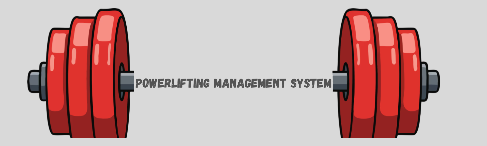
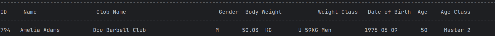
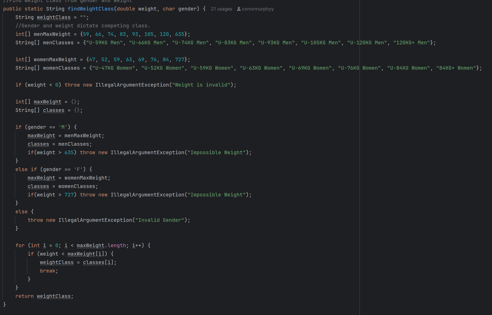
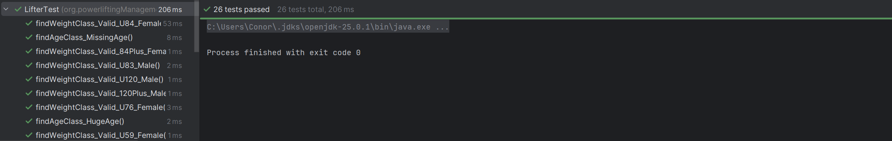
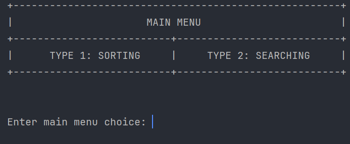
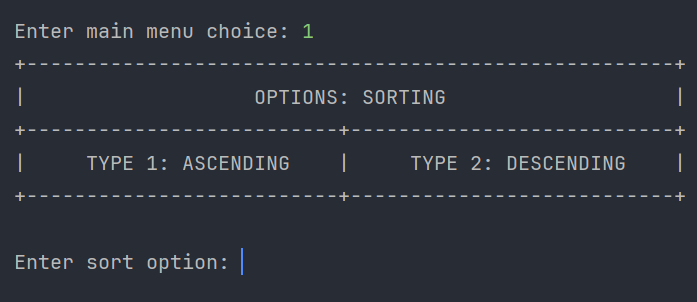
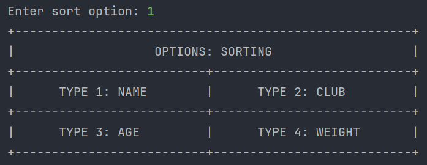
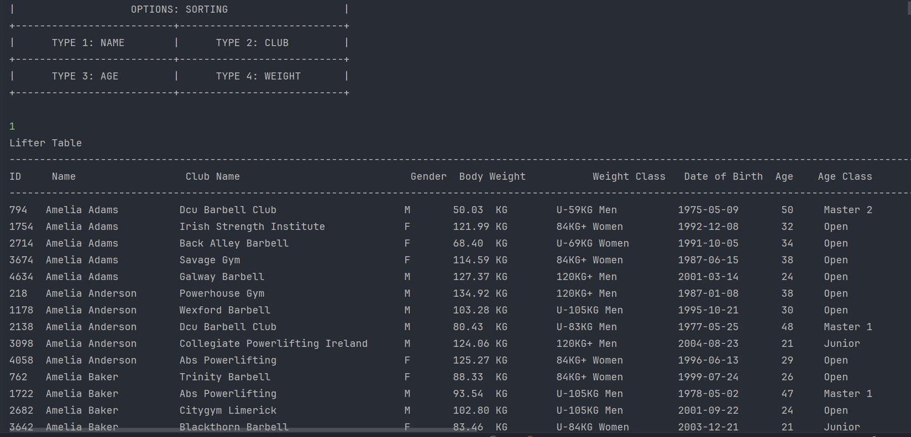

# :muscle: G-CA1 OOP: Conor Murphy & Conor McCracken
## Stage 1 :
### :one: Entity: Lifter
The "Lifter" entity represents each lifter in a powerlifting competition. This class diagram describes the lifters personal details, physical details and compeition category.

| Field              | Type      |Decription                       | Example                                       |
|:--                 |:--        |:--                              |:--                                            |
| id                 | int       | Unique ID for each lifter       | 12                                            |
| name               | String    | Lifter's full Name              | "John Smith"                                  |
| clubName           | String    | Club lifter represents          | "Odyssey Strength"                            |
| gender             | char      | Clarify the lifters gender      | 'M'                                           |
| bodyweight         | double    | Lifter's Bodyweight             | 73.9                                          |
| dateOfBirth        | LocalDate | Lifter's DOB                    | 01-02-2000                                    |
| isSponsored        | boolean   | If the lifter is sponsored      | false                                         |
| age                | int       | Lifter's age                    | 25                                            |
| ageClass           | String    | Lifter's age category           | "Junior"                                      |
| equiptmentUsedType | String [] | What equiptment type/brand used | "SBD Knee Sleeves","SBD Belt","A7 Wrist Wraps |
| weightClass        | String    | Based of gender and weight      | "U-74KG Men"                                  |
---

### :two: Lifter Overview
#### :two:.:one:  :deciduous_tree: Strucutre Tree of Lifter Folder
```
│
│
└───Lifter
        FileUtils.java
        Lifter.java
        LifterTest.java
```
#### :two:.:two:: 

---
### :three: Design Choices and Explanation
#### :three:.:one:: Methods


This method assigns a weight class to a lifter based off their weight and gender.


#### :three:.:two:: Classes and Relationships
#### :three:.:three:: Lifter J-Unit Tests

Includes testing for the application of the weight and age classes<br/>

#### :three:.:four: Sample Outputs





---


